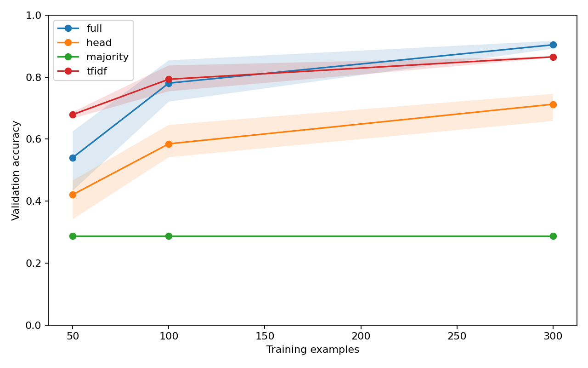
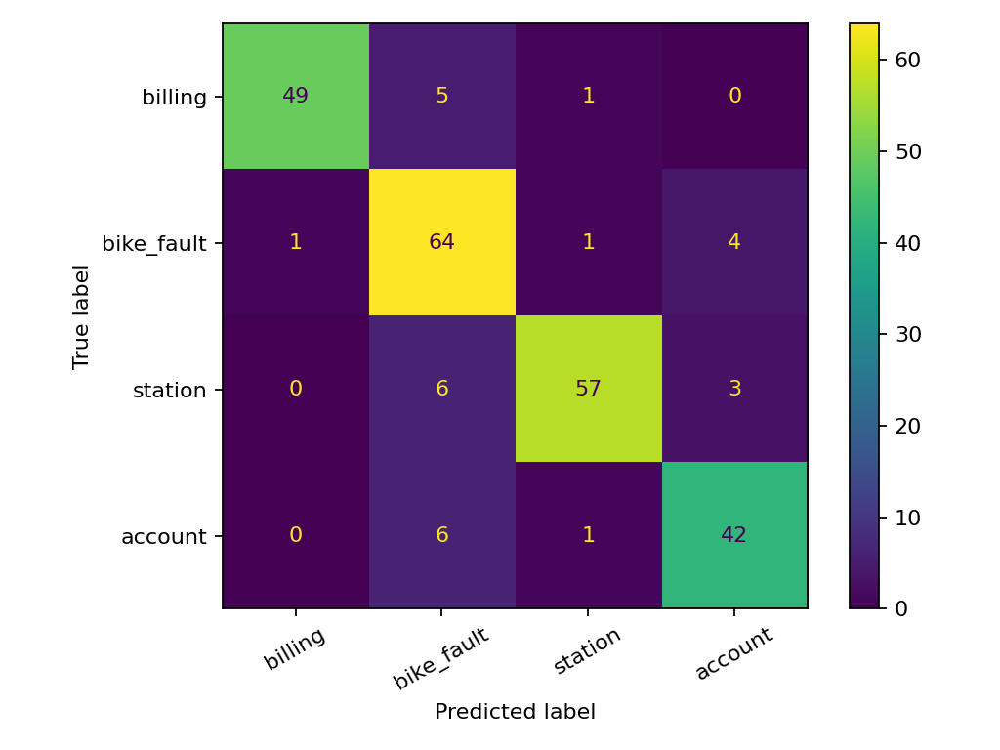

# Lakeshore Ticket Sorter: fine-tuning against a baseline

Model: https://huggingface.co/kawsarbuet/lakeshore-ticket-sorter  
Space: https://huggingface.co/spaces/kawsarbuet/lakeshore-ticket-sorter

GitHub: https://github.com/kawsarbuet/lab09-fine-tune-and-publish  
Final report: [REPORT.md](REPORT.md)

## What it does
Classifies Lakeshore Bike Share support tickets into `billing`, `bike_fault`, `station` and `account`. Compares a majority-label baseline, TF-IDF logistic regression, head-only DistilBERT and full DistilBERT fine-tuning. The selected model is deployed through a Gradio interface that returns scores for all four queues.

## How to run it
Run from the repository root using Anaconda Prompt or a terminal with Conda enabled.

```bash
conda env create -f environment.yml
conda activate lab09-fine-tune-and-publish
python -c "import torch, transformers, gradio; print(torch.__version__, torch.cuda.is_available())"
python prepare.py
python run_experiments.py --mode baseline
python run_experiments.py --mode smoke
python run_experiments.py --mode grid
# Write your own 40 messages BEFORE final evaluation.
python run_experiments.py --mode final
python app.py
# Stop the Gradio server with Ctrl+C before continuing.
python -m ruff format --check .
python -m ruff check .
python -m pytest
```

`python run_experiments.py` runs the grid and final evaluation in one command on a clean workspace, after the independent messages are ready. Model weights in `model/` are ignored; this command recreates them. The script deliberately refuses to overwrite final results; for reproduction, use a fresh clone and move the committed `reports/final.json` outside the clone first, preserving the original evidence. Do not use repeated test results to choose settings. Smoke and baseline runs write only `scratch/`; grid runs write `reports/`. First neural run needs internet. The training code automatically selects CUDA when available; otherwise it uses CPU. For CPU-only PyTorch, install the matching CPU wheel from the official PyTorch wheel index if necessary. The experiments were completed in the local Windows Conda environment. The environment specifies Python 3.12; pinned dependencies include PyTorch 2.6.0, Transformers 4.51.3, scikit-learn 1.6.1 and Gradio 5.29.0 (see [requirements.txt](requirements.txt) and [requirements-dev.txt](requirements-dev.txt)). These are declared pins, not independently verified installed versions. Verify exact installed versions with `python -m pip freeze` and reconcile the dependency pins if necessary; the installed-version list has not been supplied for this documentation update. Stop the local Gradio server with Ctrl+C before running subsequent commands.

## Data and split
Use unchanged tickets_data.py defaults: 1200 invented tickets. Label counts: billing 277, bike_fault 347, station 331, account 245. Split seed 42; 720/240/240 disjoint ticket IDs, stratified by label. Repeated text patterns may occur across distinct IDs; this is a limitation of the specified split. Training samples: 50, 100, 300; run seeds 42, 123, 2026.

## Methods
Majority and TF-IDF (unigrams/bigrams, logistic regression) are trained on the same sample as each DistilBERT variant. The body is frozen for head-only training; all weights are trainable for full fine-tuning. Dynamic batch padding, maximum length 96, batch size 16, AdamW. Validation-only pilot at 100 rows, seed 42, compares head (0.001/2 epochs vs 0.0005/3) and full (0.00002/2 vs 0.00005/3); choose the highest final validation accuracy per variant, tie by first candidate. The selected settings observed in the grid logs were head-only: learning rate 0.001, 2 epochs; full fine-tuning: learning rate 0.00005, 3 epochs. The grid uses the selected settings for all sizes and seeds. Select highest mean validation accuracy at 300 rows; choose best neural variant separately for publishing. Final refit uses predeclared seed 42 and the same 300 rows for all final methods. Baselines and best neural model are evaluated once on held-out test and own messages. No test-driven selection.

## Results
The complete grid finished successfully on November 27, 2026. The following measured validation accuracies (percent) are recorded in [summary.csv](reports/summary.csv) and [results.csv](reports/results.csv) from the 36 comparison runs. Each row summarizes three seeds.

| Method | Training samples | Mean (%) | Min (%) | Max (%) |
|---|---:|---:|---:|---:|
| Majority | 50 | 28.75 | 28.75 | 28.75 |
| Majority | 100 | 28.75 | 28.75 | 28.75 |
| Majority | 300 | 28.75 | 28.75 | 28.75 |
| TF-IDF | 50 | 67.92 | 66.67 | 68.75 |
| TF-IDF | 100 | 79.31 | 75.42 | 83.75 |
| TF-IDF | 300 | 86.53 | 86.25 | 86.67 |
| Head-only | 50 | 42.08 | 34.17 | 46.67 |
| Head-only | 100 | 58.47 | 54.17 | 64.58 |
| Head-only | 300 | 71.25 | 65.83 | 74.58 |
| Full fine-tuning | 50 | 54.03 | 43.33 | 62.50 |
| Full fine-tuning | 100 | 78.06 | 72.08 | 85.42 |
| Full fine-tuning | 300 | **90.42** | 89.17 | 91.67 |

TF-IDF led at 50 and 100 samples. At 100 samples, the observed ranges of TF-IDF and full fine-tuning overlapped. At 300 samples, full fine-tuning led TF-IDF by 3.89 percentage points, with no overlap in the observed three-seed ranges. Head-only training remained below TF-IDF at every size. Full fine-tuning was therefore selected using validation performance at 300 samples. These observed ranges are not statistical confidence intervals.



### Final evaluation: held-out test and independent messages

The completed [final.json](reports/final.json) records results for a final refit using 300 training examples and the predeclared seed 42. The held-out test contains 240 generated tickets; the independent set contains 40 messages. Head-only DistilBERT was not included in final evaluation because full fine-tuning was the selected neural variant.

| Method | Test accuracy (%) | Test macro F1 | Independent accuracy (%) | Independent macro F1 |
|---|---:|---:|---:|---:|
| Majority | 29.17 | 0.1129 | 25.00 | 0.1000 |
| TF-IDF | 83.75 | 0.8370 | 87.50 | 0.8736 |
| Full fine-tuning | **88.33** | **0.8857** | **92.50** | **0.9233** |

Full fine-tuning correctly classified 212 of 240 test tickets and 37 of 40 independent messages, compared with 201 of 240 and 35 of 40 for TF-IDF. It improved accuracy by 4.58 percentage points on the test set and 5.00 points on the independent set. Both methods scored higher on the independent set than on the synthetic test set; this small comparison does not establish whether synthetic data systematically inflates performance. Macro F1 weights all four categories equally.

**Recommendation:** Use the selected full fine-tuned model in a supervised pilot, retaining TF-IDF as a lightweight alternative. Reconsider the choice if a larger, independently labeled real-customer dataset fails to show a meaningful advantage for fine-tuning.

### Final confusion matrix

The matrix below shows the validation-selected winner (full fine-tuning) on the 240 held-out test tickets.



Experiment evidence: [all runs](reports/results.csv), [summary](reports/summary.csv), [selected settings](reports/settings.json), [epoch logs](reports/epochs.csv), [tuning runs](reports/tuning.csv), [tuning epochs](reports/tuning_epochs.csv) and [final epochs](reports/final_epochs.csv).

## Own 40 messages

The independent evaluation dataset is stored in
`data/own_messages.csv` with the columns `text` and `label`.

It contains 40 unique support messages, equally distributed
across the four classification categories:

| Category | Number of messages |
|---|---:|
| billing | 10 |
| bike_fault | 10 |
| station | 10 |
| account | 10 |
| **Total** | **40** |

The messages include varied sentence lengths, natural customer
inquiries and occasional spelling mistakes to evaluate model
robustness beyond the repetitive patterns of the synthetic dataset.

This dataset is reserved exclusively for final independent
evaluation and is not intended for training, validation or
hyperparameter selection.

The lab requires personally authored messages. An AI-generated
draft was used during preparation; final personal authorship
must be confirmed before submission.

## Publishing

The fine-tuned DistilBERT model and Gradio application were
successfully published on Hugging Face on November 27, 2026.

- **Model:** https://huggingface.co/kawsarbuet/lakeshore-ticket-sorter
- **Space:** https://huggingface.co/spaces/kawsarbuet/lakeshore-ticket-sorter

The publication process successfully uploaded the trained
model weights (`model.safetensors`, approximately 268 MB),
tokenizer, model configuration and model card.

The Hugging Face Space container logs confirmed successful
Gradio application startup on `0.0.0.0:7860`.

### Authentication and deployment

The Python authentication API was used as an alternative
to the Hugging Face CLI due to a Windows command availability
issue.

```bash
python -c "from huggingface_hub import login; login()"
python -c "from huggingface_hub import HfApi; print(HfApi().whoami()['name'])"
python publish.py --model-id kawsarbuet/lakeshore-ticket-sorter --space-id kawsarbuet/lakeshore-ticket-sorter
```

The publication script uploads the trained model and configures
the Gradio Space to load the model directly from Hugging Face.

Access tokens and trained model weights must not be committed
to GitHub. Authentication credentials are managed locally.

Hugging Face Spaces provides the public application URL,
so enabling `share=True` is unnecessary.

Public accessibility and inference functionality should be
verified in a private browser window before submission.

## Tests

The project incorporates automated testing and code quality
verification using pytest and Ruff.

The local verification process included:

- Ruff code formatting.
- Ruff linting and import-order validation.
- Correction of I001 and E501 linting errors.
- Stratified dataset splitting and sampling tests.
- Baseline model performance tests.
- Tokenization and classification tests.
- Frozen and trainable model parameter verification.
- Model reproducibility and persistence tests.
- Local Gradio application testing across all four categories.
- Empty-input handling and classification score verification.

### Run verification checks

```bash
python -m ruff format --check .
python -m ruff check .
python -m pytest
```

The automated neural-network tests use a small, randomly
initialized DistilBERT model to enable efficient offline testing.
The actual experiments use the pretrained DistilBERT model.

The original instructor-provided `tickets_data.py` remains
subject to the unchanged-file requirement.

Local verification was reported as completed; exact pytest counts and fresh-clone outputs are not included in the package. All three
mandatory checks must also pass from a fresh GitHub clone
to confirm repository reproducibility.

## Limitations

Although full DistilBERT fine-tuning achieved promising
validation performance, several limitations remain:

- The primary dataset contains synthetic support messages
  rather than actual customer inquiries.
- Repeated sentence patterns may overestimate generalization
  performance.
- Vague and mixed-topic messages introduce classification
  ambiguity.
- Limited training sample sizes may affect model robustness.
- Model performance can vary across random seeds and
  computing environments.
- Predicted probabilities are not calibrated confidence
  estimates.
- Independent evaluation contains only 40 messages.
- No evaluation using actual customer support records
  has been conducted.

The application is intended as a support-ticket classification
prototype rather than a production-ready automated routing
system. Human review is recommended for ambiguous or
low-confidence predictions.

Future improvements could include larger real-world datasets,
confidence calibration, additional model comparisons and
continuous performance monitoring.

**Additional documentation:** See [SETUP_AND_SUBMISSION.md](SETUP_AND_SUBMISSION.md) for detailed setup, troubleshooting and submission procedures, and [REPORT.md](REPORT.md) for the support-lead report.
